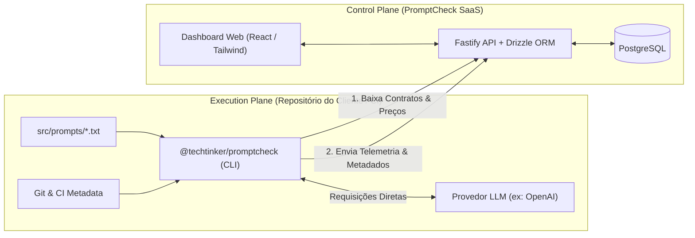

# PromptCheck

> **Contratos de Prompts, Detecção de Regressão & Governança de Drift para Sistemas de IA**  
> *Desenvolvido pela TechTinker — Design System moderno, Dev-First (estilo Vercel/Linear), TypeScript & Privacy by Design.*

---

## 🎯 Visão Geral

O **PromptCheck** é uma plataforma híbrida de testes de contrato e governança contínua para engenharia de prompts e LLMs. Ele permite que times de engenharia, QA e produto garantam que prompts integrados a sistemas de produção nunca quebrem contratos estruturais de dados ou sofram degradação silenciosa por atualizações de modelos de fundação.



---

## 🔒 Princípios de Privacy by Design (LGPD)

- **Zero Output da LLM no SaaS:** A resposta bruta gerada pelo modelo nunca é enviada ao SaaS.
- **Zero Texto de Prompt no SaaS:** Os prompts residem exclusivamente no repositório do cliente; o SaaS recebe apenas um `prompt_hash` canônico (SHA-256).
- **Dados Sintéticos no SaaS:** O Gold Dataset cadastrado na interface aceita exclusivamente dados sintéticos/fixtures com aviso proativo de LGPD.
- **Diffs de Erro Seguros:** Relatórios de falha contêm unicamente metadados estruturais (`json_path`, `rule_violated`, `expected_type`, `received_type`).
- **Anonimização no Git:** `commit_author` captura apenas o handle público do dev, descartando e-mails.
- **Zero API Keys no SaaS:** Chaves de provedores de IA ficam nos secrets do cliente; o Project Token trafega via header `Authorization: Bearer <token>` e fica no banco como hash SHA-256.

---

## 📐 Regra de Detecção de Drift

O status da execução transiciona para **Aviso de Drift** (`status: warning`, cor âmbar) quando o `prompt_hash` e a `contract_version` permanecem idênticos à última execução de referência da branch principal, mas ocorre:

1. **`FINGERPRINT_CHANGED`**: O provedor atualizou silenciosamente o `system_fingerprint` do modelo.
2. **`PASS_RATE_DROPPED`**: Queda na taxa de aprovação além da tolerância configurável (padrão: 5 pontos percentuais).
3. **`LATENCY_INCREASED`**: Aumento de latência média superior a 50%.

---

## 🏗️ Estrutura do Monorepo

```
promptcheck/
├── apps/
│   ├── api/            # Fastify + Drizzle ORM + PostgreSQL (Control Plane)
│   └── web/            # Vite + React + Tailwind CSS + TanStack Query (Dashboard)
├── packages/
│   ├── shared/         # Zod schemas (.strict()), tipos, detectores de segredos e hashes
│   └── cli/            # @techtinker/promptcheck — CLI Node.js com binário promptcheck
├── docs/               # requisitos.md, guia_ui_ux.md, arquitetura.md
├── docker-compose.yml  # PostgreSQL 16 local
└── pnpm-workspace.yaml # Configuração de monorepo pnpm workspaces
```

---

## 🚀 Começando

### 1. Pré-requisitos
- **Node.js:** `>= 20.0.0`
- **pnpm:** `>= 10.0.0` (recomendado: `12.14.0`)
- **Docker & Docker Compose:** para o PostgreSQL local

### 2. Clonar e Instalar Dependências

```bash
git clone https://github.com/techtinker/promptcheck.git
cd promptcheck
pnpm install
```

### 3. Iniciar o Banco de Dados

```bash
docker compose up -d
```

### 4. Configurar Variáveis de Ambiente

Copie o arquivo de exemplo para a API:

```bash
cp .env.example apps/api/.env
```

Execute as migrações/push do schema:

```bash
pnpm --filter @promptcheck/api run db:push
```

### 5. Iniciar Serviços em Modo de Desenvolvimento

```bash
# Iniciar a API e o Dashboard simultaneamente:
pnpm run dev

# Ou se preferir em terminais separados:
# Terminal 1: pnpm run dev:api (API Fastify na porta 3333)
# Terminal 2: pnpm run dev:web (Dashboard Vite na porta 5173)
```

- **Dashboard Web:** [http://localhost:5173](http://localhost:5173)
- **API Fastify:** [http://localhost:3333](http://localhost:3333) (Health check: `/health`)

---

## 💻 Usando a CLI

Dentro de qualquer repositório que utilize prompts e LLMs:

```bash
# 1. Inicializar configuração interativa
npx @techtinker/promptcheck init

# 2. Configurar credenciais
export PROMPTCHECK_TOKEN="pck_live_..."
export OPENAI_API_KEY="sk-proj-..."

# 3. Rodar os testes
npx @techtinker/promptcheck test
```

---

## 🛠️ Scripts do Monorepo

| Comando | Descrição |
|---|---|
| `pnpm run build` | Compila todos os pacotes (`shared`, `cli`, `api`, `web`) |
| `pnpm test` | Executa todos os testes unitários com Vitest |
| `pnpm run typecheck` | Executa validação de tipos TypeScript estrita em todos os pacotes |
| `pnpm run lint` | Executa checagem de código com Biome |
| `pnpm run lint:fix` | Corrige problemas de formatação e lint automaticamente |

---

## 📄 Licença

Este projeto é licenciado sob a licença **MIT** — consulte o arquivo [LICENSE](LICENSE) para detalhes.
