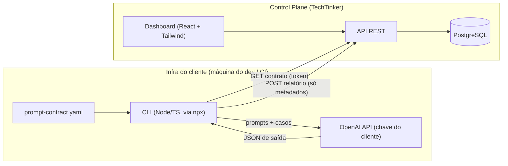

# Análise — PromptCheck (requisitos.md + guia_ui_ux.md × AGENTS.md)

## 1. Entendimento do produto

**PromptCheck** é um micro-SaaS de *contract testing* para prompts de LLM, voltado a times de engenharia. Ele resolve dois problemas:

| Problema | O que significa | Como o produto detecta |
| --- | --- | --- |
| **Regressão** | Alguém altera o prompt e a saída deixa de seguir o contrato (JSON) que o backend consome | Validação determinística do JSON contra um JSON Schema (Ajv) |
| **Drift** | O provedor atualiza o modelo sem avisar e o comportamento muda, mesmo sem nenhuma alteração de código | Comparação histórica entre execuções (**hoje não está especificado**, ver §3.1) |

### Arquitetura em dois planos (*split-plane*)



A ideia central do *privacy by design*: **a chave de LLM e as saídas do modelo nunca saem da infraestrutura do cliente**. O SaaS só recebe metadados.

### Escopo do MVP
- **Dashboard:** autenticação, projetos + tokens, CRUD de contratos (schema + Gold Dataset), histórico de runs, métricas (pass rate, latência, custo, campos quebrados) e diff entre runs.
- **CLI:** `init` (gera o yaml) e `test` (busca o contrato → chama a LLM em paralelo → valida → envia o relatório → `exit 1` se ficar abaixo de `--fail-under`).
- **UI:** dark mode no estilo Vercel/Linear, mono para código e hashes, verde/vermelho/âmbar para pass/fail/drift, onboarding em 3 passos e diff lado a lado.

---

## 2. Conflitos entre os documentos e o AGENTS.md

O AGENTS.md tem precedência. Estes são os pontos em que os docs divergem dele:

| # | Ponto | requisitos / guia | AGENTS.md | Resolução proposta |
| --- | --- | --- | --- | --- |
| C1 | Linguagem da CLI | "Node/TS **ou Python**" | TypeScript puro + `commander` + `ajv` | **TypeScript** |
| C2 | Token na URL | `GET /api/v1/projects/{token}/contract` | §4.4: tokens nunca podem aparecer em logs | O token na URL vai parar em logs de proxy, CDN e APM. Mover para o header `Authorization: Bearer <token>` e usar rotas `/api/v1/cli/contracts` e `/api/v1/cli/runs` |
| C3 | Armazenamento do token | `project_token` (String, Unique), ou seja, em texto puro | §4.1: hash (Argon2/SHA-256) | Guardar `token_hash` (SHA-256, determinístico e indexável) + `token_prefix` para exibição. O token completo aparece só uma vez, na criação |
| C4 | Autenticação | "Email/Senha ou OAuth" | JWT em cookie HTTP-only + Refresh Token | Seguir o AGENTS. O modelo de dados precisa de `users` e `refresh_tokens` |
| C5 | Diff "esperado vs. recebido" | O guia pede o **valor recebido** no diff | Nunca persistir dados brutos | O diff mostra só **path + regra violada + tipo** (ex.: `$.price` esperava `number`, recebeu `string`), nunca o valor |
| C6 | i18n | Ausente nos docs | pt-BR + en-US (fallback en), `--lang`, códigos de erro em inglês | Incluir no escopo desde o início, porque retrofit é caro |
| C7 | Segurança da API | Ausente | Zod, body limit, rate limit, CORS `*.techtinker.com.br`, TLS | Incluir no escopo do MVP |

---

## 3. Lacunas nos requisitos

### 3.1 Críticas (bloqueiam o design)

1. **Drift não tem requisito funcional.** É metade da proposta de valor e a cor âmbar existe na UI, mas nenhum RF define a regra. Proposta para o MVP:
   - A run registra `model`, `system_fingerprint` (retornado pela OpenAI) e `prompt_hash`.
   - **Drift** = queda de pass rate ou mudança de `system_fingerprint` em relação à última run de referência, **com o mesmo `prompt_hash` e a mesma versão de contrato**. Sem mudança de código, a mudança vem do modelo.
   - Recomendar execuções agendadas (cron no GitHub Actions) no onboarding, já que drift acontece sem PR.
2. **Onde fica o prompt?** O contrato tem `prompt_name` e o schema, mas não tem o texto do prompt, o modelo nem os parâmetros (temperature etc.). Sem isso, a CLI não sabe o que enviar à LLM. O mais provável, e mais alinhado à privacidade, é que o prompt fique **no repositório do cliente**, referenciado no yaml, e o SaaS receba apenas o `prompt_hash`.
3. **Gold Dataset × "não reter dados brutos".** Os `test_cases` (inputs) ficam no SaaS, o que entra em tensão com o RNF01 e com o AGENTS §2.2. É preciso decidir:
   - **(a)** Os casos são *fixtures* criadas pelo usuário no dashboard, não dados de clientes finais. Fica aceitável, com um aviso na UI para não colar PII; **ou**
   - **(b)** Os casos ficam no repositório (arquivos locais) e o SaaS guarda só o schema e os IDs dos casos.
4. **Versionamento de contrato.** O "diff de versões" e a detecção de drift exigem saber contra **qual versão** do contrato a run executou. Hoje `test_runs` não tem nem `contract_id`.
5. **Endpoint singular `/contract`.** Um projeto tem N contratos. Falta definir se a CLI busca todos ou filtra pelos `prompt_name` listados no yaml.

### 3.2 Importantes

6. **"Comportamento esperado"** nos casos de teste não tem semântica definida, porque o RF03 é só estrutural. No MVP: só schema, ou asserções determinísticas simples (`equals`, `contains`, `enum`)? *LLM-as-judge* fica fora do MVP.
7. **Modelo de dados incompleto.** Faltam:
   - `users`, `refresh_tokens` e o vínculo `projects.owner_id` (ou `organizations` + `memberships`, se houver times).
   - Em `test_runs`: `contract_version_id`, `status` (pass/fail/warning), `fail_under`, `model`, `provider`, `system_fingerprint`, `prompt_hash`, `total_tokens`, `commit_author` (o guia exige o badge), `ci_run_url`, `cli_version`.
   - IDs estáveis por caso de teste dentro do JSONB, para cruzar resultado × caso.
8. **Custo estimado.** Falta definir de onde vem a tabela de preços por modelo: embutida na CLI (desatualiza) ou servida pela API (`GET /api/v1/cli/pricing`).
9. **Token no `prompt-contract.yaml`.** Esse arquivo é commitado. O `init` **não pode** gravar o token nele: o token deve vir de `PROMPTCHECK_TOKEN` (env/secret do CI).
10. **Schema do payload de telemetria (RF04)** não está especificado. Proposta: um schema Zod `.strict()` compartilhado entre CLI e API, com limites de tamanho em strings e uma heurística que rejeita padrões de segredo (`sk-…`, `AKIA…`).
11. **Nomenclatura inconsistente:** `PromptCheck`, `prompt-contract` (CLI/yaml) e `@techtinker/promptcheck` (guia). Definir um nome único.

### 3.3 Menores
- Concorrência limitada + retry com backoff + timeout nas chamadas à LLM (o RNF02 não menciona o rate limit da OpenAI).
- Draft do JSON Schema (recomendo **2020-12**). Validar o schema com Ajv já no momento de salvar no dashboard.
- Se o cliente usa *Structured Outputs* (`response_format: json_schema`) em produção, a CLI deve reproduzir a mesma configuração, senão o teste não representa a produção.
- Revogação/rotação de token, política de retenção de runs (LGPD) e planos/limites de uso: não aparecem em lugar nenhum. Podem ficar fora do MVP, mas convém registrar.
- O `commit_author` é dado pessoal (LGPD): guardar só o username do git, não o e-mail.
- O guia tem um `---` duplicado e o seu §4 já foi incorporado ao AGENTS.md.
- O AGENTS §2.1 ainda tem a stack do backend como "[Definir stack…]".

---

## 4. Proposta de arquitetura técnica (para validação)

**Monorepo TypeScript (pnpm workspaces).** O maior ganho é compartilhar os schemas Zod do contrato de telemetria entre CLI e API: o "não aceitar dado bruto" fica garantido pelo tipo dos dois lados.

```
promptcheck/
├── apps/
│   ├── api/          # Fastify + Drizzle + PostgreSQL (rotas / services / repositories separados)
│   └── web/          # Vite + React + Tailwind + TanStack Query + i18next + Lucide
├── packages/
│   ├── cli/          # commander + ajv + fetch nativo + i18n próprio (en/pt)
│   └── shared/       # Zod schemas (RunReport, Contract), códigos de erro, tipos
└── docs/
```

| Camada | Escolha sugerida | Motivo |
| --- | --- | --- |
| API | **Fastify** | Leve e rápido (RNF04), plugins oficiais de rate-limit, CORS e cookie, `bodyLimit` nativo |
| ORM | **Drizzle** | Sem engine binária, SQL explícito, bom suporte a JSONB |
| Web | **Vite + React** | Dashboard atrás de login não precisa de SSR. Next.js seria peso extra |
| Auth | JWT próprio (access 15 min + refresh rotativo em cookie HTTP-only) + Argon2 + OAuth GitHub (opcional) | Atende o AGENTS §4.1 sem vendor lock-in |
| Rate limit | `@fastify/rate-limit` em memória no MVP → Redis ao escalar horizontalmente | |

---

## 5. Decisões pendentes (preciso do seu input)

1. **Gold Dataset:** fica no SaaS (a) ou no repositório do cliente (b)? (§3.1-3)
2. **Prompt:** confirma que o texto do prompt fica no repositório do cliente e o SaaS recebe só o hash?
3. **Regra de drift no MVP:** aceita a proposta do §3.1-1?
4. **Stack do backend:** Fastify + Drizzle + Vite, conforme o §4?
5. **Nome do pacote/CLI:** `@techtinker/promptcheck` com binário `promptcheck` e arquivo `promptcheck.yaml`?
6. **Multi-tenant:** só usuário → projetos, ou organizações/times já no MVP?
7. **"Comportamento esperado":** só schema, ou asserções determinísticas simples também?
